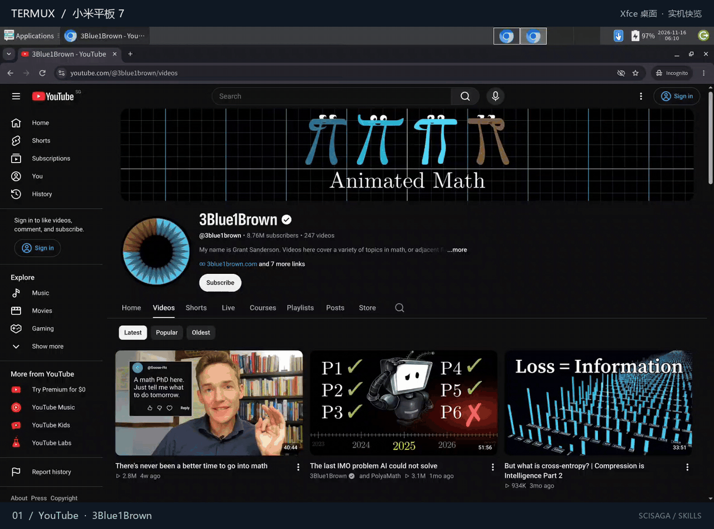

# Scisaga Toolkit

[简体中文](README.md) | English

Nine practical skills for Codex and Claude Code, covering Android workstations, presentations and narration, documents and video, service deployment, domains, and developer collaboration.

## Skills

Open a skill to find its workflow, commands, and configuration guide. Detailed skill documentation is primarily in Chinese.

| Icon | Skill | Capabilities |
|:---:|---|---|
|  | [`termux`](skills/termux/)<br>Android workstation | **Native environment:** install or migrate Termux; configure SSH, boot services, shared storage, API access, Bluetooth, and on-device Codex.<br>**Desktop and apps:** optionally deploy X11, Debian/Xfce, VS Code, Chromium, LibreOffice, and VLC, with Android desktop management and app launchers.<br>**Device support:** troubleshoot display, touch, keyboard and mouse input, GPU, VPN/DNS, background processes, and power use; verify actual functionality and performance.<br>[Watch the Xiaomi Pad 7 demo ↓](#termux-device-demo) |
|  | [`slides`](skills/slides/)<br>Presentations and narration | **From script to slides:** preserve page-by-page scripts and use plans or Markdown as source material for technical diagrams, architecture, workflows, and roadmaps. Reuse templates, add animations, or revise individual SVG slides.<br>**Narration:** arrange pacing, pauses, and technical pronunciation; audition or replace voices. Prefer self-hosted Qwen3, falling back to Azure for the entire audio set when needed.<br>**Deliverables:** per-slide MP3, static/animated/narrated PPTX, or MP4 exported through Windows PowerPoint. Set slide timing from real audio durations, rebuild affected outputs, and run staged quality checks. |
|  | [`dev-ops`](skills/dev-ops/)<br>Service deployment | Manage Compose stacks, configuration templates, environment variables, and remote rollouts. Covers GitLab, databases, object storage, proxies, WireGuard, DDNS, DNS, and certificate synchronization, with shared service entry points and hardcoded-value audits. |
|  | [`domain-manager`](skills/domain-manager/)<br>Domains and DNS | Query and manage Gandi and Dynadot domains, DNS records, nameservers, DNSSEC, contacts, renewals, and transfers. Supports sandbox requests; preview and confirm writes, then read back the resulting state. |
|  | [`gitlab-issue`](skills/gitlab-issue/)<br>Issue collaboration | Search, create, and update issues in the current self-hosted GitLab repository. Manage labels, descriptions, and comments; close, reopen, or delete issues. Verify that the repository matches the trusted instance before sending a token. |
|  | [`pdf`](skills/pdf/)<br>Document processing | Locally merge, split, extract, replace, remove, reorder, and rotate pages. Add text-preserving watermarks, rasterized watermarks, or seals spanning page edges; batch-process directories and convert between PDFs and images. |
|  | [`speech`](skills/speech/)<br>Speech synthesis and transcription | Turn short text or long scripts into MP3, discover voices, and use supported style, rate, and pitch controls. Prefer Qwen3 with whole-input Azure fallback, recording the actual backend and voice. Transcribe meetings, interviews, and other audio through self-hosted Qwen3 ASR. |
|  | [`subtitle-matcher`](skills/subtitle-matcher/)<br>Batch subtitle matching | Scan movie and TV directories and find Chinese subtitles from ASSRT, SubHD, and other sources. Rank by release version, download and validate candidates, and compare timing against embedded subtitle tracks. Normalize VLC auto-loading filenames and generate HTML reports with review items and playback links. |
|  | [`video`](skills/video/)<br>Video tools | Extract keyframes and audio, find existing subtitles or generate SRT through ASR, mux subtitles, and check synchronization. Includes cross-platform FFmpeg installation and online research for movie summaries and reviews. |

### Termux device demo

Recorded on a Xiaomi Pad 7: YouTube (3Blue1Brown) → GitHub → VLC video playback → maximized VS Code, running a Python Snake game from the integrated terminal. Edited into a 9-second loop; approximately 1.5 MB.



[Snake example source](skills/termux/assets/demo/snake.py) · Run `python3 snake.py` inside Debian/Xfce; install `python3-tk` if Tk is missing. Use arrow keys or WASD to move, Space to pause, and R to restart.

The VLC clip comes from [MDN's flower sample video](https://interactive-examples.mdn.mozilla.net/media/cc0-videos/flower.mp4).

## Installation and updates

The plugin is named `scisaga`, and its marketplace is `scisaga-skills`. For example, the source skill `slides` is invoked as `scisaga:slides` in the plugin and installed as `ss-slides` by default in standalone mode. The root `plugin.json` is the single source of truth for the version.

Install [Codex](https://developers.openai.com/codex/cli/) or [Claude Code](https://code.claude.com/docs/en/setup), and have Python 3 and Git available:

```bash
python -m pip install -r requirements-tools.txt
python scripts/manage_skills.py install --agent codex --mode plugin
python scripts/manage_skills.py install --agent claude-code --mode plugin
```

These commands track `main` in GitHub's `Scisaga/skills` repository. **Use `--source .` for local, unpublished changes.** Pin a tag or commit with `--ref <tag-or-commit>`. Plugins are installed through each client's native commands. Invoke `$scisaga:slides` in Codex or `/scisaga:slides` in Claude Code.

For standalone skills, including Codex IDE workflows:

```bash
python scripts/manage_skills.py install --agent codex --mode standalone --skill slides --source .
python scripts/manage_skills.py install --agent codex --mode standalone --skill video --alias speech=my-speech --source .
```

Standalone names use the `ss-` prefix by default. Use an alias such as `--alias slides=my-slides` to coexist with another skill of the same name. Installing `video` also installs `speech` and resolves calls through the installation mapping. Updates preserve aliases and local configuration.

```bash
python scripts/manage_skills.py check --agent codex --mode plugin --remote
python scripts/manage_skills.py update --agent codex --mode plugin
python scripts/manage_skills.py launch codex --
```

`launch codex` attempts an update before starting, with a 60-second limit. If updating fails and a usable installation exists, it starts that version. Running `codex` directly does not guarantee this update check. In Claude Code, enable automatic updates under `/plugin` → Marketplaces → `scisaga-skills`; updates take effect after reloading or in the next session. See the [installation and update specification](spec/installation-and-updates.md) for conflict handling, isolated testing, migration, and removal.

Installing a skill, preparing Python/system dependencies, and configuring external services are separate steps. Speech/Slides prefer Qwen for narration and try Azure for the entire input if it fails. Configuration comes from the project's `.env` or an external `--env-file`. Qwen-only use does not require an Azure key or SDK; see the [Speech usage guide](skills/speech/references/usage.md).

## Repository structure

```text
.
├── skills/
│   ├── termux/
│   ├── slides/
│   ├── dev-ops/
│   ├── domain-manager/
│   ├── gitlab-issue/
│   ├── pdf/
│   ├── speech/
│   ├── subtitle-matcher/
│   └── video/
├── template/
│   └── skill-template/
├── assets/demos/
├── spec/
├── scripts/manage_skills.py
├── plugin.json
├── .codex-plugin/
├── .claude-plugin/
├── .agents/plugins/marketplace.json
├── .env.example
├── AGENTS.md
├── README.md
└── README.en.md
```

## Directory roles

- `skills/`: usable skills and their resources.
- `template/`: starter structure for creating a skill.
- `assets/demos/`: device demonstrations used in the README.
- `spec/`: repository structure and authoring conventions.

## Distribution

- `skills/` is the sole skill source. Plugins use short skill names; standalone installations generate prefixed or aliased views.
- The root `plugin.json` defines the plugin identity and version. Generate and validate compatible manifests with `package --sync-manifests`.
- `package` uses an allowlist and excludes real `.env` files, virtual environments, caches, and generated build outputs.

## Common entry points

```bash
bash skills/termux/scripts/run.sh help
bash skills/slides/scripts/run.sh help
bash skills/domain-manager/scripts/run.sh help
bash skills/gitlab-issue/scripts/run.sh help
bash skills/pdf/scripts/run.sh help
bash skills/speech/scripts/run.sh help
bash skills/subtitle-matcher/scripts/run.sh help
bash skills/video/scripts/run.sh help
bash skills/dev-ops/scripts/run.sh help
```

## Environment variables

See [.env.example](.env.example) for the repository-wide configuration template. Put project configuration in the current project's `.env`; use `--env-file` for shared configuration outside the plugin cache. Speech/Slides keep existing process variables and fill missing values from the explicit file, current directory, skill directory, then script directory, in that order. Calls from other projects do not automatically load the source repository's root `.env`. Do not commit secrets or proxy URLs containing credentials.

## Maintenance

- Keep repository-level documentation and conventions at the root, and actual skills under `skills/`.
- Keep each skill self-contained, with at least a `SKILL.md`.
- Put detailed documentation in `references/`.
- Put stable, reusable workflows in `scripts/`.
- Put output resources and templates in `assets/`.

See `AGENTS.md` and `spec/` for the full conventions.
